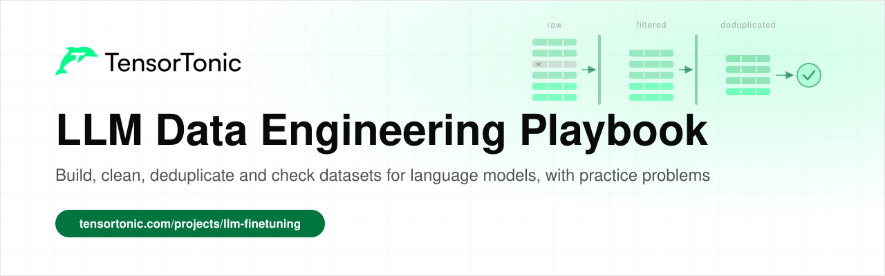
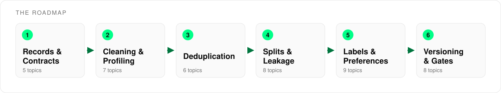

# LLM Data Engineering Playbook

  

This is a playbook for building the datasets that language models are trained, fine-tuned and evaluated on. It covers 43 topics across six stages, from defining a valid record to deciding whether a new dataset version is safe to release.

Every topic links to a short explanation and to practice problems where you implement the technique in Python and check your code against tests. Most data problems never crash a pipeline. They show up later as a leaked benchmark score or a model that learned from duplicates, so the goal is to make each check something you have built yourself.

## Table of Contents

- [Who this is for](#who-this-is-for)
- [How to use this roadmap](#how-to-use-this-roadmap)
- [Stage 1: Records and Contracts](#stage-1-records-and-contracts)
- [Stage 2: Cleaning and Profiling](#stage-2-cleaning-and-profiling)
- [Stage 3: Deduplication](#stage-3-deduplication)
- [Stage 4: Splits, Sampling and Leakage](#stage-4-splits-sampling-and-leakage)
- [Stage 5: Labels and Preference Data](#stage-5-labels-and-preference-data)
- [Stage 6: Versioning, Drift and Release Gates](#stage-6-versioning-drift-and-release-gates)
- [What's next](#whats-next)

## Who this is for

This playbook is for anyone who prepares data for language models and wants the quality of that data to be measured instead of assumed.

- If you are **fine-tuning a model**, stages 1, 2 and 5 cover how to turn raw records into clean training and preference examples.
- If you are **training from scratch**, the deduplication, tokenization and data mixture topics matter most at pretraining scale.
- If you **own an evaluation or release process**, stages 4 and 6 cover leakage, contamination, drift and the checks that should block a release.

You need basic Python and some comfort with simple statistics. You do not need a cluster, since every technique here can be practiced on a few hundred records.

## How to use this roadmap

The stages follow the life of a record. It is validated against a contract, cleaned and profiled, deduplicated, split, labelled, and finally versioned and checked before release. A split made before deduplication leaks copies across the boundary, so the order matters.

For each topic, read the explanation first, then solve one or two of the practice problems. Topics without a practice link are still worth reading, because the later checks depend on the decisions they describe.

## Stage 1: Records and Contracts

A dataset is only as good as its definition of a valid example. This stage covers what a training example should contain, how to record it at the moment it happens, and how to reject or repair records that break the contract before they reach training.

| Topic | Read | Practice |
| --- | --- | --- |
| What a training example is | [What is LLM fine-tuning?](https://www.tensortonic.com/projects/llm-finetuning/materials/what-is-fine-tuning) | |
| Logging the moment of prediction | [Logging training examples](https://www.tensortonic.com/ml-design/logging) | |
| Schemas and data contracts | | [ETL Schema Validation](https://www.tensortonic.com/problems/etl-schema-validation) |
| Missing values | | [Impute Missing Values (mean/median)](https://www.tensortonic.com/problems/impute-missing), [Handle Missing Values](https://www.tensortonic.com/problems/pandas-handle-missing) |
| Text normalization | | [Text Normalization](https://www.tensortonic.com/problems/nlp-text-normalization), [Remove Stopwords From a Token List](https://www.tensortonic.com/problems/remove-stopwords) |

## Stage 2: Cleaning and Profiling

Profiling tells you what the data actually looks like before you decide what to remove. This stage starts with simple summaries and outliers, then moves to the text-specific views of a corpus, such as token counts, tokenizer behaviour and how surprising each document is to a reference model.

| Topic | Read | Practice |
| --- | --- | --- |
| Descriptive profiling | [What are descriptive statistics?](https://www.tensortonic.com/ml-math/statistics/basic-statistics) | [Mean, Median and Mode](https://www.tensortonic.com/problems/mean-median-mode), [Percentiles / Quantiles](https://www.tensortonic.com/problems/percentiles) |
| Outliers and robust scaling | | [Robust Scaling](https://www.tensortonic.com/problems/robust-scaling), [Winsorize Data by Percentile](https://www.tensortonic.com/problems/winsorization) |
| Skewed distributions | | [Log Transform Features](https://www.tensortonic.com/problems/log-transform), [Skewness and Kurtosis](https://www.tensortonic.com/problems/probstat-skewness-kurtosis) |
| Word and length counts | | [Word Count Dictionary](https://www.tensortonic.com/problems/word-count-dict) |
| Tokenizer training | [How GPT pretraining prepares text](https://www.tensortonic.com/llm-internals/gpt-pretraining) | [Train a BPE Tokenizer From Scratch](https://www.tensortonic.com/problems/cs336-l01-train-byte-pair-encoding), [Apply Ranked BPE Merges](https://www.tensortonic.com/problems/cs336-l01-apply-bpe-merge-ranks) |
| Perplexity filtering | [What is perplexity?](https://www.tensortonic.com/ml-math/information-theory/perplexity) | [Compute Conditional Perplexity](https://www.tensortonic.com/problems/cs336-l12-conditional-perplexity), [Perplexity Computation](https://www.tensortonic.com/problems/perplexity-computation) |
| Entropy and diversity | [What is Shannon entropy?](https://www.tensortonic.com/ml-math/information-theory/shannon-entropy) | [Compute Entropy for a Node](https://www.tensortonic.com/problems/entropy-node) |

## Stage 3: Deduplication

Duplicates waste compute, make a model memorise repeated text and quietly inflate evaluation scores. Exact copies are cheap to remove with a hash, while near-duplicates need a similarity measure and a threshold that you choose and defend.

| Topic | Read | Practice |
| --- | --- | --- |
| Exact deduplication | | [Perform Stable Exact Deduplication](https://www.tensortonic.com/problems/cs336-l14-stable-exact-deduplication), [ETL Deduplication](https://www.tensortonic.com/problems/etl-deduplication) |
| Duplicates in tables | | [Drop Duplicates](https://www.tensortonic.com/problems/pandas-drop-duplicates), [ROW_NUMBER](https://www.tensortonic.com/problems/sql-row-number) |
| Shingles and Jaccard similarity | | [Jaccard Similarity](https://www.tensortonic.com/problems/jaccard-similarity) |
| MinHash signatures | | [Build Deterministic MinHash Signatures](https://www.tensortonic.com/problems/cs336-l14-minhash-signatures), [Text Deduplication (MinHash)](https://www.tensortonic.com/problems/nlp-text-deduplication-minhash) |
| Bag-of-words and TF-IDF vectors | | [Bag-of-Words Vector](https://www.tensortonic.com/problems/bag-of-words), [TF-IDF Vectorizer](https://www.tensortonic.com/problems/tfidf-vectorizer) |
| Embedding similarity | [Embeddings and similarity search](https://www.tensortonic.com/ml-design/embeddings) | [Cosine Similarity](https://www.tensortonic.com/problems/cosine-similarity) |

## Stage 4: Splits, Sampling and Leakage

An evaluation is only honest if nothing from the test side reached training. This stage covers how to split by group and by time, how to keep rare cases represented, how to weight data sources against each other, and how benchmark items end up inside training corpora.

| Topic | Read | Practice |
| --- | --- | --- |
| Stratified splits | [Data splits and leakage](https://www.tensortonic.com/ml-design/leakage) | [Stratified Train/Test Split](https://www.tensortonic.com/problems/stratified-split) |
| Cross-validation folds | | [K-Fold Split (Indices Only)](https://www.tensortonic.com/problems/kfold-split) |
| Group leakage | [Data splits and leakage](https://www.tensortonic.com/ml-design/leakage) | |
| Time-based splits | | [Time-Based Split with a Gap](https://www.tensortonic.com/problems/time-based-split-with-gap) |
| Point-in-time correctness | [Feature stores and consistency](https://www.tensortonic.com/ml-design/feature-consistency) | [Point-in-Time Feature Join](https://www.tensortonic.com/problems/point-in-time-feature-join) |
| Rare classes and sampling | [Rare events and class imbalance](https://www.tensortonic.com/ml-design/sampling) | [Stratified Sampling](https://www.tensortonic.com/problems/probstat-stratified-sampling) |
| Data mixtures | [GPT pretraining](https://www.tensortonic.com/llm-internals/gpt-pretraining) | [Compute Temperature-Based Data Mixtures](https://www.tensortonic.com/problems/cs336-l14-temperature-data-mixture), [Extrapolate Data-Mixture Scaling Curves](https://www.tensortonic.com/problems/cs336-l09-data-mixture-extrapolation) |
| Benchmark contamination | [Evaluating generated answers](https://www.tensortonic.com/ml-design/generative-evaluation) | |

## Stage 5: Labels and Preference Data

Labels and preferences are the part of the dataset that people produce, so they carry disagreement, bias and mistakes. This stage covers how to define and audit labels, how to measure agreement between annotators, and how chat and preference examples are shaped for fine-tuning, RLHF and DPO.

| Topic | Read | Practice |
| --- | --- | --- |
| Label definitions and delayed outcomes | [Labels and delayed outcomes](https://www.tensortonic.com/ml-design/labels) | |
| Annotator agreement | | [Cohen's Kappa](https://www.tensortonic.com/problems/cohens-kappa) |
| Auditing label errors | [Classification metrics and thresholds](https://www.tensortonic.com/ml-design/classification-metrics) | [Compute Confusion Matrix with Normalization](https://www.tensortonic.com/problems/confusion-matrix-norm) |
| SFT examples and loss masks | [How to fine-tune an LLM](https://www.tensortonic.com/projects/llm-finetuning/materials/how-to-fine-tune) | [Build an Assistant-Only SFT Loss Mask](https://www.tensortonic.com/problems/cs336-l15-assistant-only-sft-mask) |
| Preference pairs | [RLHF explained](https://www.tensortonic.com/llm-internals/rlhf) | [Canonicalize Pairwise Preference Data](https://www.tensortonic.com/problems/cs336-l15-canonical-preference-pairs), [Bradley-Terry Reward Model Loss](https://www.tensortonic.com/problems/rl-bradley-terry-reward-loss) |
| Preference data for DPO | [DPO explained](https://www.tensortonic.com/llm-internals/dpo) | [Implement the DPO Loss](https://www.tensortonic.com/problems/cs336-l15-direct-preference-optimization-loss) |
| Judge bias in labels | [Evaluating generated answers](https://www.tensortonic.com/ml-design/generative-evaluation) | [Remove Response-Length Bias from Judge Scores](https://www.tensortonic.com/problems/cs336-l12-judge-length-debiasing) |
| Filtering synthetic data | | [BLEU Score](https://www.tensortonic.com/problems/bleu-score) |
| Error analysis by slice | [Error analysis and evaluation slices](https://www.tensortonic.com/ml-design/error-analysis) | |

## Stage 6: Versioning, Drift and Release Gates

A dataset changes every time a source, a filter or a split rule changes, and each version needs a record of what was done to it. This stage covers lineage, comparing a new version against the last approved one, and the checks that decide whether it ships.

| Topic | Read | Practice |
| --- | --- | --- |
| Lineage and versioning | [Training pipelines and versioning](https://www.tensortonic.com/ml-design/training) | [ETL Dependency Orchestration](https://www.tensortonic.com/problems/etl-dependency-orchestration) |
| Distribution drift | [Monitoring and drift](https://www.tensortonic.com/ml-design/monitoring) | [Data Drift Detection](https://www.tensortonic.com/problems/data-drift-detection), [Chi-Square Test](https://www.tensortonic.com/problems/chi2-independence) |
| Histograms for comparison | | [Binning](https://www.tensortonic.com/problems/binning) |
| Train-serving skew | [Feature stores and consistency](https://www.tensortonic.com/ml-design/feature-consistency) | [Detect Train-Serving Skew](https://www.tensortonic.com/problems/train-serving-skew) |
| Choosing quality metrics | | [Monitoring Metrics Selection](https://www.tensortonic.com/problems/monitoring-metrics-selection) |
| Retraining triggers | [When and how to retrain](https://www.tensortonic.com/ml-design/retraining) | [Retraining Trigger Design](https://www.tensortonic.com/problems/retraining-trigger-design) |
| Release gates and shadow evaluation | [A/B testing and safe rollout](https://www.tensortonic.com/ml-design/experiments) | [Shadow Deployment Evaluation](https://www.tensortonic.com/problems/shadow-deployment-evaluation) |
| Feedback loops | [Feedback loops and exposure bias](https://www.tensortonic.com/ml-design/feedback-loops) | |

## What's next

Once these checks feel familiar, use them on a real training run. The [fine-tuning project](https://www.tensortonic.com/projects/llm-finetuning/qwen3-medical-qa) walks through preparing data and training an adapter, the [DPO project](https://www.tensortonic.com/projects/dpo-from-scratch) builds on preference pairs, and the [Build LLM from Scratch study plan](https://www.tensortonic.com/study-plans/language-modeling-from-scratch) covers tokenization, deduplication and data mixtures alongside the rest of the training stack.

## License

MIT
